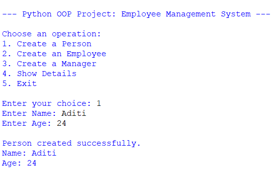
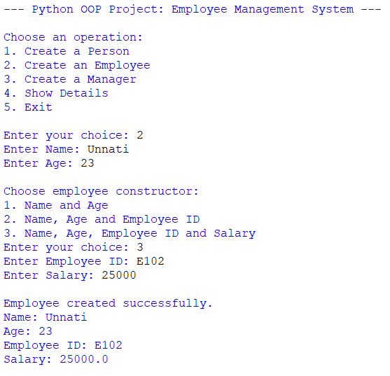
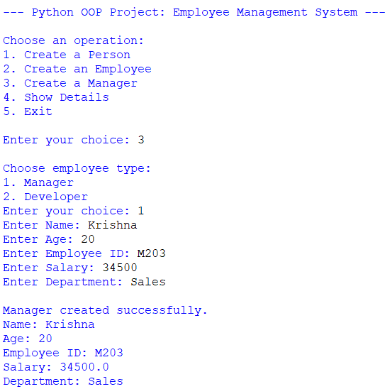
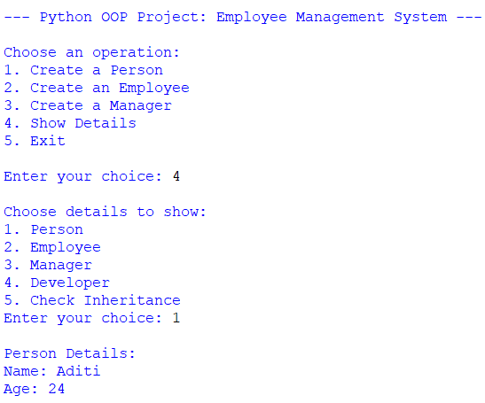
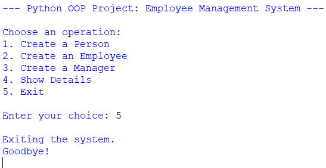

# 🧩 Project 5 – OOP Wrapper

<div align="center">

### 🐍 Employee Management System Using Python OOP

**Classes • Objects • Inheritance • Encapsulation • Polymorphism**

<br>


</div>

---

## ✨ Overview

**OOP Wrapper – Employee Management System** is a menu-driven Python console application created to demonstrate object-oriented programming concepts. It models people, employees, managers, and developers using classes, inheritance, encapsulation, constructors, and method overriding.

Users can create records, display details by category, check class inheritance, and exit the application through the main menu.

---

## 🎯 Project Objectives

- Practice classes and objects in Python.
- Implement inheritance using base and derived classes.
- Protect sensitive employee data through encapsulation.
- Demonstrate constructor behavior for different argument counts.
- Override methods in derived classes.
- Use `super()` to call parent-class methods.
- Check inheritance relationships using `issubclass()`.
- Build a menu-driven console interface.

---

## 🚀 Features

```text
👤 Create a Person
🧑‍💼 Create an Employee
🧑‍💼 Create a Manager
💻 Create a Developer
🔐 Encapsulate Employee ID and Salary
🔁 Create Employee objects using different argument patterns
🧬 Demonstrate Inheritance and Method Overriding
🔎 Check Inheritance using issubclass()
📋 Display Details by Record Type
🚪 Exit the Program
```

---

## 🧱 Classes and Responsibilities

| Class | Description |
|---|---|
| `Person` | Stores a person's name and age and displays those details. |
| `Employee` | Inherits from `Person`, stores private employee ID and salary, and provides getter/setter properties. |
| `Manager` | Inherits from `Employee` and adds a department. |
| `Developer` | Inherits from `Employee` and adds a programming language. |

---

## 🧠 Python OOP Concepts Used

| Concept | Implementation |
|---|---|
| Classes and Objects | `Person`, `Employee`, `Manager`, and `Developer` |
| Constructor | `__init__()` initializes object attributes |
| Destructor | `__del__()` is defined in `Employee` |
| `self` | Accesses instance attributes and methods |
| Inheritance | `Employee` inherits from `Person`; `Manager` and `Developer` inherit from `Employee` |
| Encapsulation | `__employee_id` and `__salary` are private attributes |
| Getter and Setter | `@property` and setter methods access or update private attributes |
| Method Overloading Pattern | `Employee.__init__(*args)` supports different argument counts |
| Method Overriding | `Manager.display()` and `Developer.display()` customize display output |
| `super()` | Calls parent constructors and parent display methods |
| `issubclass()` | Checks whether classes inherit from other classes |
| `isinstance()` | Identifies manager and developer objects when displaying records |
| Conditional Statements | Handle menu choices and constructor options |
| Loops | Keep the menu running until the user exits |
| Lists | Store created records during program execution |
| Functions | Separate record creation and display operations |

### Method Overloading Pattern

Python does not support traditional method overloading by defining multiple methods with the same name and different parameter lists. This project uses `*args` and checks the number of arguments to provide different constructor behaviors.

```python
Employee("Jane Smith", 28)
Employee("Jane Smith", 28, "E123")
Employee("Jane Smith", 28, "E123", 50000)
```

---

## 🔄 Program Workflow

```text
                  ┌─────────────────┐
                  │      START      │
                  └────────┬────────┘
                           │
                           ▼
                  ┌─────────────────┐
                  │    MAIN MENU    │
                  └────────┬────────┘
                           │
          ┌────────────────┼────────────────┐
          │                │                │
          ▼                ▼                ▼
   Create Person    Create Employee   Create Manager
                                           │
                                           ▼
                                    Create Developer

                           │
                           ▼
                    Show Details
                           │
                           ▼
                  Check Inheritance
                           │
                           ▼
                      Exit Program
```

---

## 🖥️ Example Usage

### Create a Person

```text
Choose an operation:
1. Create a Person
2. Create an Employee
3. Create a Manager
4. Show Details
5. Exit

Enter your choice: 1

Enter Name: John Doe
Enter Age: 30

Person created successfully.
Name: John Doe
Age: 30
```

### Create an Employee

```text
Enter your choice: 2

Enter Name: Jane Smith
Enter Age: 28

Choose employee constructor:
1. Name and Age
2. Name, Age and Employee ID
3. Name, Age, Employee ID and Salary

Enter your choice: 3
Enter Employee ID: E123
Enter Salary: 50000

Employee created successfully.
Name: Jane Smith
Age: 28
Employee ID: E123
Salary: 50000.0
```

### Check Inheritance

```text
Choose details to show:
1. Person
2. Employee
3. Manager
4. Developer
5. Check Inheritance

Enter your choice: 5

Manager is subclass of Employee: True
Developer is subclass of Employee: True
Employee is subclass of Person: True
```

---

## 📸 Output Screenshots

The following screenshots are stored in the `Output` folder.

<div align="center">



<br><br>



<br><br>



<br><br>



<br><br>



</div>

---

## 🎬 Project Demonstration

The demonstration video presents the execution of the Employee Management System, including creating records, displaying details, and checking inheritance.

<div align="center">

### ▶️ Complete Project Demonstration

</div>

[▶️ Watch Project Demonstration](Project%20Demonstration.mov)

---

## 📂 Project Structure

```text
Project - 5 OOP Wrapper/
│
├── Output/
│   ├── output-1.png
│   ├── output-2.png
│   ├── output-3.png
│   ├── output-4.png
│   └── output-5.png
│
├── Project - 5 OOP Wrapper.py
├── Project Demonstration.mov
└── README.md
```

---

## ⚙️ How to Run

### 1. Check Python

```bash
python --version
```

Or:

```bash
python3 --version
```

### 2. Run the Program

Run the command from the project folder, using the actual Python filename:

```bash
python "Project - 5 OOP Wrapper.py"
```

Or:

```bash
python3 "Project - 5 OOP Wrapper.py"
```

---

## 📋 Main Functions

```python
create_person()
create_employee()
create_manager()
create_developer()
show_details(records)
main()
```

---

## 🎓 Learning Outcomes

By completing this project, the learner practices:

- Creating classes and objects.
- Using constructors and destructors.
- Applying inheritance and encapsulation.
- Using getter and setter properties.
- Implementing constructor behavior with `*args`.
- Overriding methods in derived classes.
- Calling parent methods with `super()`.
- Checking class relationships with `issubclass()`.
- Building a menu-driven application.
- Organizing code into reusable functions.

---

## 📦 Requirements

- Python 3.x
- No external libraries required

---

## 👤 Developer

<div align="center">

### ADITI MODHVADIYA

**Python Developer • MERN Stack Developer**

<br>

🐍 Built with Python

</div>

---

<div align="center">

### ⭐ Project 5 – OOP Wrapper

**Create → Manage → Display → Check Inheritance → Exit**

</div>
