# ⚡ Multi-Utility Toolkit

<div align="center">

### 🐍 A Menu-Driven Python Modules & Packages Project

**Date & Time • Mathematics • Random Data • UUID • File Operations**

<br>


</div>

---

## ✨ Overview

**Multi-Utility Toolkit** is a menu-driven Python console application that demonstrates Python's built-in modules, custom modules, packages, and module importing.

The toolkit includes date and time utilities, mathematical calculations, random data generation, UUID generation, file handling, and module attribute exploration. Custom file and mathematics functions are organized in the `toolkit` package.

---

## 🎯 Project Features

```text
🕒  Date and Time Operations
🧮  Mathematical Calculations
🎲  Random Number and List Generation
🔐  Random Password and OTP Generation
🎯  Random Sampling and Dice Game
🆔  UUID Generation
📁  File Create, Write, Read, and Append
📦  Custom Modules and Package
🔍  Explore Module Attributes using dir()
🚪  Exit Program
```

---

## 🧩 Program Workflow

```text
                         ┌──────────────────┐
                         │      START       │
                         └────────┬─────────┘
                                  │
                                  ▼
                         ┌──────────────────┐
                         │    MAIN MENU     │
                         └────────┬─────────┘
                                  │
          ┌─────────────┬─────────┼─────────┬─────────────┐
          ▼             ▼         ▼         ▼             ▼
      Date & Time   Mathematics Random    UUID       File Tools
          │             │       Data       │             │
          ▼             ▼         ▼        ▼             ▼
       Stopwatch    Area/Units  Password  Unique     Create/Read/
       Countdown    Factorial   OTP/Game  Identifier Write/Append
          │             │         │        │             │
          └─────────────┴─────────┴────────┴─────────────┘
                                  │
                                  ▼
                         Explore Modules
                                  │
                                  ▼
                                 EXIT
```

---

# 🚀 Features

### 🕒 Date and Time Operations

The datetime menu provides:

- Display the current date and time.
- Calculate the difference between two dates.
- Format a date using a custom format.
- Run a stopwatch.
- Run a countdown timer.

Python modules and functions used include `datetime.datetime.now()`, `datetime.datetime.strptime()`, `strftime()`, `time.time()`, and `time.sleep()`.

---

### 🧮 Mathematical Operations

The mathematics menu provides:

- Calculate the factorial of a non-negative integer.
- Calculate compound interest and the total amount.
- Calculate sine, cosine, tangent, and natural logarithm.
- Calculate the area of a circle, rectangle, or triangle.
- Convert values between kilometres, metres, and centimetres.

The project uses functions from the built-in `math` module and custom functions from `toolkit.math_utilities`.

---

### 🎲 Random Data Generation

The random menu provides:

- Generate a random integer within a chosen range.
- Generate a list of random integers.
- Create a random password.
- Generate a numeric OTP.
- Select a random sample from entered values.
- Play a dice-guessing game.

The project uses `random.randint()`, `random.choice()`, and `random.sample()`.

**Note:** The password and OTP features use Python's `random` module for this learning project. This is not suitable for generating security-critical passwords or authentication codes.

---

### 🆔 UUID Generation

Generates a unique identifier using:

```python
uuid.uuid4()
```

UUIDs can be used as identifiers in applications and data records.

---

### 📁 File Operations

The file menu allows users to:

- Create a new file.
- Write data to a file.
- Read a file's contents.
- Append data to a file.

These operations are implemented in the custom module `toolkit/file_operations.py`. The functions handle common file errors, such as a file already existing or a file not being found.

---

### 📦 Custom Modules and Package

The project separates reusable functions into modules inside the `toolkit` package:

- `file_operations.py` contains file-handling functions.
- `math_utilities.py` contains unit-conversion and area-calculation functions.
- `__init__.py` imports the package's utility functions.

The main program imports these functions and uses them in the menus.

---

### 🔍 Explore Module Attributes

The module explorer accepts a supported module name and displays its attributes with:

```python
dir()
```

Supported modules include `datetime`, `math`, `random`, `time`, `uuid`, `toolkit.file_operations`, and `toolkit.math_utilities`.

---

## 🛠️ Python Concepts Used

| Concept | Usage |
|---|---|
| Built-in modules | Date/time, mathematics, random values, and UUIDs |
| Custom modules | Separate reusable file and math functions |
| Packages | Organize modules in the `toolkit` directory |
| Import statements | Use built-in and custom functionality |
| Functions | Organize program operations |
| Loops | Keep menus running until the user exits |
| Conditional statements | Process menu selections |
| Exception handling | Handle file and unit-conversion errors |
| File handling | Create, write, read, and append files |
| List comprehension | Generate a list of random integers |
| `dir()` | Explore module attributes |
| `__init__.py` | Initialize the `toolkit` package |
| `if __name__ == "__main__":` | Run the main menu when the main script is executed directly |

---

## 🖥️ Output

<div align="center">

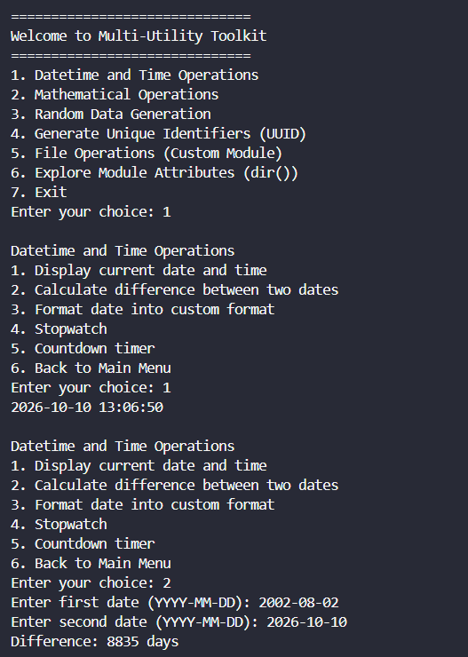

<br><br>

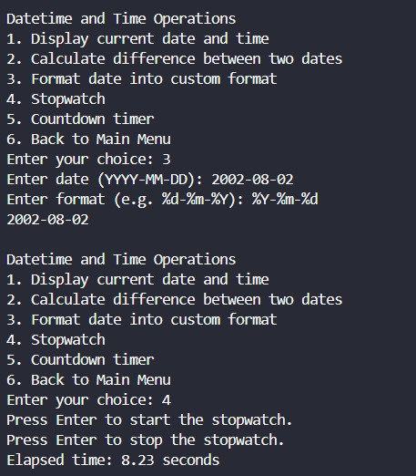

<br><br>

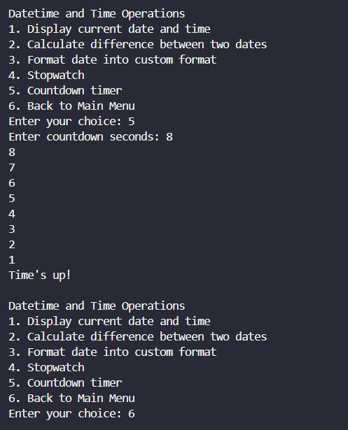

<br><br>

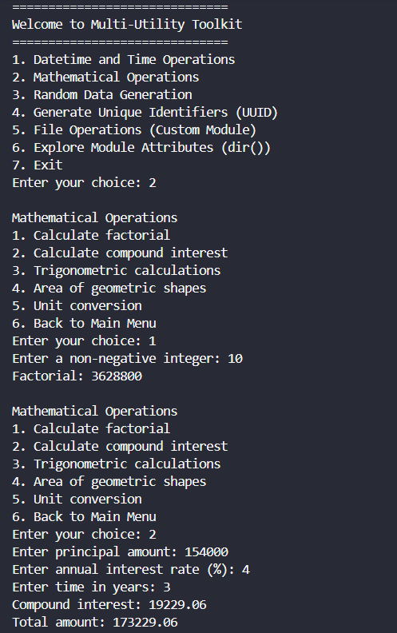

<br><br>

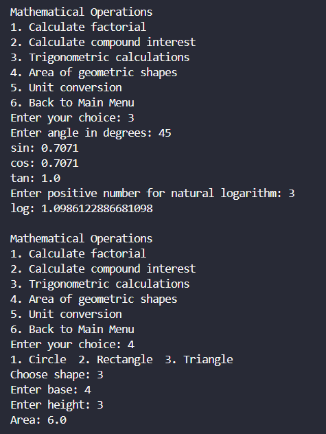

<br><br>

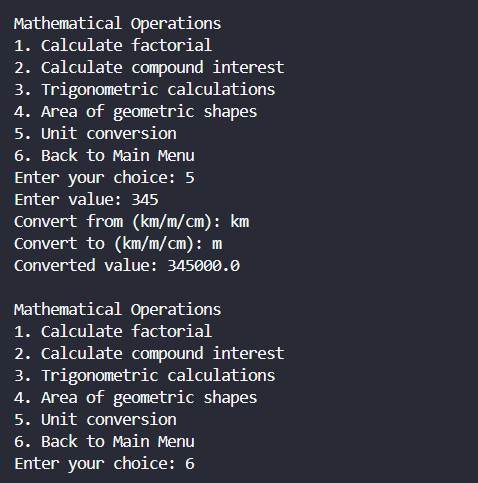

<br><br>

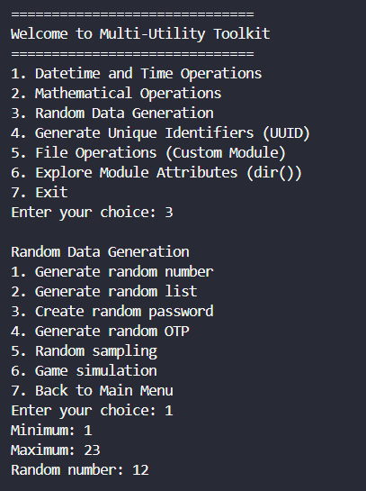

<br><br>

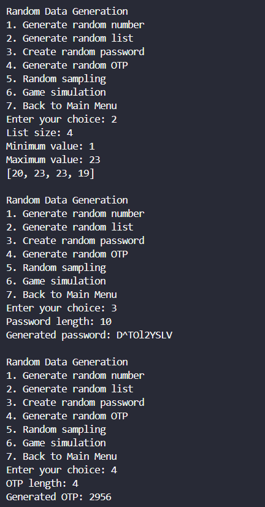

<br><br>

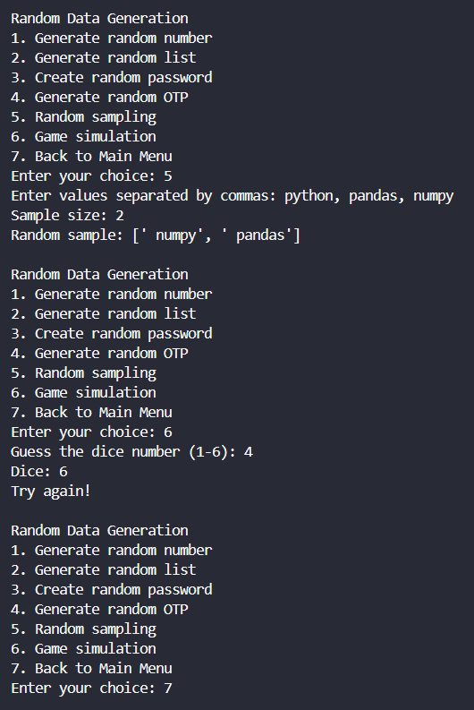

<br><br>

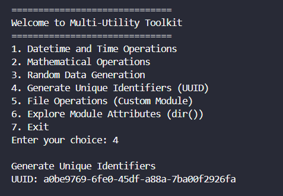

<br><br>

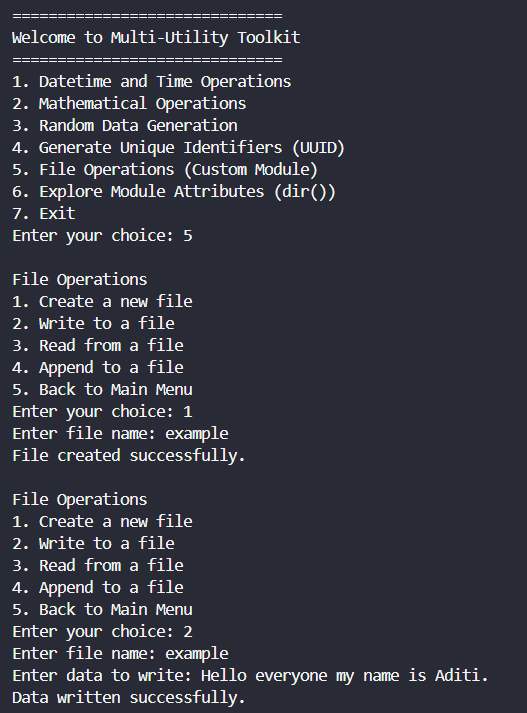

<br><br>

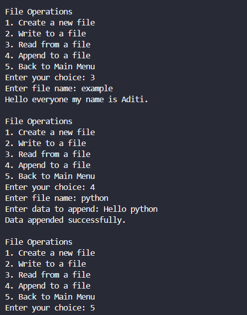

<br><br>

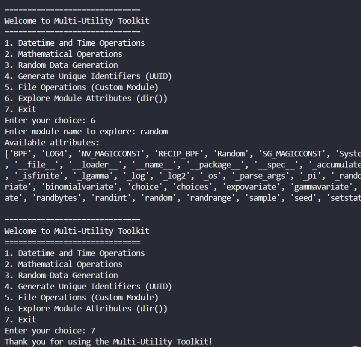

</div>

---

# 🎬 Project Demonstration

<div align="center">

### ▶️ Complete Project Demonstration

</div>

The demonstration video is included in the project folder and shows the menu-driven toolkit in action.

[▶️ Watch Project Demonstration](Project%20Demonstration.mp4)

---

# 📂 Project Structure

```text
Project - 5 Moduler & Packager/
│
├── Project - 5 Moduler & Packager.py
├── Project Demonstration.mp4
├── README.md
│
├── Output/
│   ├── output-1.1.png
│   ├── output-1.2.png
│   ├── output-1.3.png
│   ├── output-2.1.png
│   ├── output-2.2.png
│   ├── output-2.3.png
│   ├── output-3.1.png
│   ├── output-3.2.png
│   ├── output-3.3.png
│   ├── output-4.png
│   ├── output-5.1.png
│   ├── output-5.2.png
│   └── output-6.png
│
└── toolkit/
    ├── __init__.py
    ├── file_operations.py
    └── math_utilities.py
```

---

# ⚙️ How to Run

### 1. Check Python

```bash
python --version
```

Or:

```bash
python3 --version
```

### 2. Open the Project Folder

Open a terminal in the `Project - 5 Moduler & Packager` directory.

### 3. Run the Program

On Windows:

```bash
python "Project - 5 Moduler & Packager.py"
```

On macOS or Linux, if `python` refers to Python 2 or is unavailable:

```bash
python3 "Project - 5 Moduler & Packager.py"
```

Keep the `toolkit` folder in the same project directory as the main Python file so the imports work correctly.

---

# 📋 Main Functions

### Main program — `Project - 5 Moduler & Packager.py`

```python
datetime_menu()
math_menu()
random_menu()
uuid_menu()
file_menu()
explore_module()
main()
```

- `datetime_menu()` — displays date/time, calculates date differences, formats dates, and provides stopwatch and countdown features.
- `math_menu()` — handles factorial, compound interest, trigonometry, logarithms, shape areas, and unit conversions.
- `random_menu()` — generates random values, lists, passwords, and OTPs; performs sampling and runs a dice game.
- `uuid_menu()` — generates a UUID4 identifier.
- `file_menu()` — provides a menu for file creation, writing, reading, and appending.
- `explore_module()` — lists attributes of supported modules using `dir()`.
- `main()` — displays the main menu and directs the user's selection.

### `toolkit/file_operations.py`

```python
create_file(filename)
write_file(filename, data)
read_file(filename)
append_file(filename, data)
```

- `create_file(filename)` — creates a new file and reports if it already exists.
- `write_file(filename, data)` — writes text to a file.
- `read_file(filename)` — reads and returns file contents.
- `append_file(filename, data)` — appends text to a file.

### `toolkit/math_utilities.py`

```python
convert_units(value, source, target)
calculate_area(shape, first, second=None)
```

- `convert_units(value, source, target)` — converts between `km`, `m`, and `cm`.
- `calculate_area(shape, first, second=None)` — calculates the area of a circle, rectangle, or triangle.

---

# 📚 Modules and Functions Demonstrated

| Module / Function | Purpose |
|---|---|
| `datetime` | Work with dates and times |
| `datetime.datetime.now()` | Get the current date and time |
| `datetime.datetime.strptime()` | Parse a date string |
| `strftime()` | Format date/time output |
| `time.time()` | Measure elapsed time |
| `time.sleep()` | Pause during countdown |
| `math.factorial()` | Calculate factorial |
| `math.radians()` | Convert degrees to radians |
| `math.sin()` / `math.cos()` / `math.tan()` | Calculate trigonometric values |
| `math.log()` | Calculate natural logarithm |
| `random.randint()` | Generate a random integer |
| `random.choice()` | Select a random character |
| `random.sample()` | Select random items |
| `uuid.uuid4()` | Generate a UUID |
| `dir()` | List module attributes |
| `open()` | Open files for reading and writing |
| `try` / `except` | Handle errors |
| `__import__()` | Import a module dynamically |
| `__init__.py` | Define the `toolkit` package imports |
| `if __name__ == "__main__":` | Control direct program execution |

---

# 🎓 Learning Outcomes

This project provides practice with:

```text
✓ Python Built-in Modules
✓ Custom Modules and Packages
✓ Importing and Reusing Functions
✓ Date and Time Processing
✓ Mathematical Calculations
✓ Random Number Generation
✓ Password and OTP Generation
✓ UUID Creation
✓ File Handling
✓ Exception Handling
✓ Module Attribute Exploration
✓ Menu-Driven Programming
✓ Main-Module Execution Pattern
```

---

# 📦 Requirements

- Python 3.x
- No external libraries are required.

---

# 👤 Developer

<div align="center">

## ADITI MODHVADIA

**Python Developer • MERN Stack Developer**

<br>

🐍 Built with Python

</div>

---

<div align="center">

### ⭐ Multi-Utility Toolkit

**Import → Calculate → Generate → Manage Files → Explore Modules**

</div>