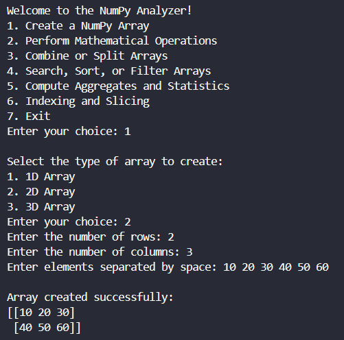
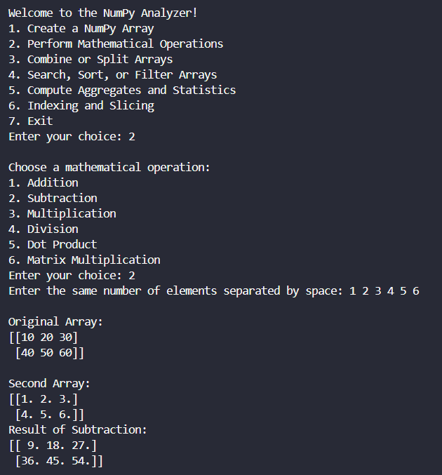
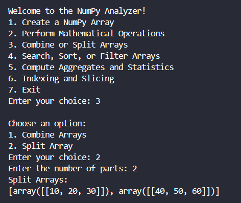
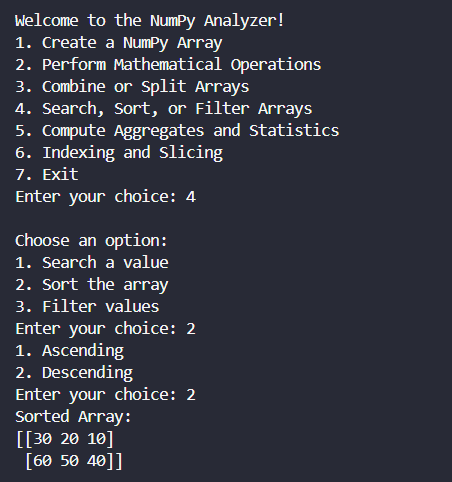
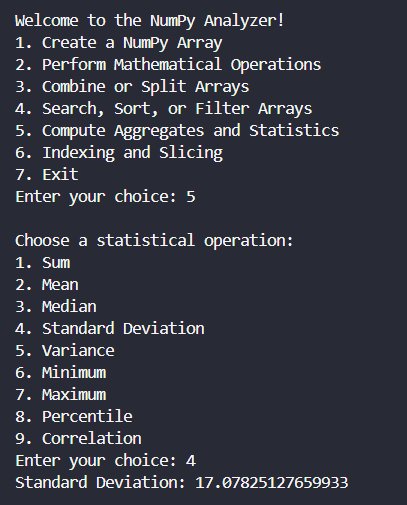
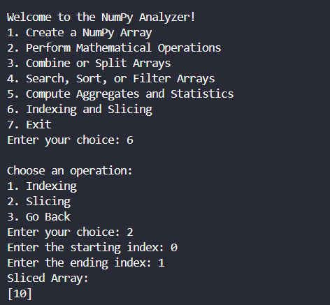
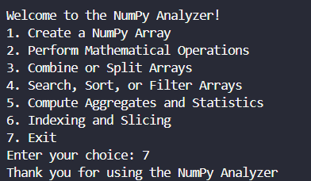

# 🧩 Project 8 – NumPy Analyzer

<div align="center">

### 🐍 NumPy Array Operations and Statistical Analysis

**NumPy • Arrays • Mathematical Operations • Statistics • Object-Oriented Programming**

<br>


</div>

---

## ✨ Overview

**NumPy Analyzer** is a menu-driven Python console application that uses NumPy to create and process one-dimensional, two-dimensional, and three-dimensional arrays. It provides options for indexing, slicing, mathematical calculations, array combining and splitting, searching, sorting, filtering, and statistical analysis.

The application is organized around the `DataAnalytics` class, which stores the current array and provides methods for performing the available operations.

---

## 🎯 Project Objectives

- Create NumPy arrays with 1D, 2D, and 3D shapes.
- Access array values using indexing and slicing.
- Perform element-wise arithmetic operations.
- Calculate dot products and matrix multiplication.
- Combine and split arrays.
- Search, sort, and filter array values.
- Calculate aggregate and statistical results.
- Apply basic object-oriented programming by grouping operations in a class.
- Build a menu-driven console application.

---

## 🚀 Features

```text
🔢 Create 1D, 2D, and 3D NumPy Arrays
📍 Access Elements Using Indexing
✂️ Slice Array Values
➕ Addition and Subtraction
✖️ Element-wise Multiplication
➗ Division with a Zero-Division Check
🔗 Dot Product and Matrix Multiplication
🧩 Combine and Split Arrays
🔍 Search for Values
↕️ Sort Values in Ascending or Descending Order
🎯 Filter Values Greater Than a Given Number
📊 Calculate Sum, Mean, Median, Standard Deviation, and Variance
📉 Find Minimum, Maximum, Percentiles, and Correlation Coefficients
🚪 Exit Through the Main Menu
```

---

## 🧱 Class and Method Responsibilities

| Class / Method | Description |
|---|---|
| `DataAnalytics` | Stores the current NumPy array and provides the project's operations. |
| `__init__()` | Initializes `self.array` to `None`. |
| `create_array()` | Creates a 1D, 2D, or 3D array from user input. |
| `indexing_slicing()` | Displays an element by index or returns a flattened slice. |
| `mathematical_operations()` | Performs addition, subtraction, element-wise multiplication, division, dot product, or matrix multiplication. |
| `combine_split_arrays()` | Combines the current array with another array or splits the current array into parts. |
| `search_sort_filter()` | Searches for a value, sorts values, or filters values greater than a chosen number. |
| `aggregates_statistics()` | Calculates aggregate and statistical results. |

---

## 🧠 NumPy Concepts Used

| Concept | Implementation |
|---|---|
| Array creation | `np.array()` |
| Array reshaping | `reshape()` |
| Array dimensions and size | `ndim`, `size`, and `shape` |
| Indexing | `self.array.flat[index]` |
| Slicing | `self.array.flat[start:end]` |
| Addition and subtraction | `+` and `-` |
| Element-wise multiplication | `*` |
| Division | `/` with a zero-value check |
| Dot product | `np.dot()` |
| Matrix multiplication | `np.matmul()` |
| Combining arrays | `np.concatenate()` |
| Splitting arrays | `np.array_split()` |
| Searching | `np.where()` |
| Sorting | `np.sort()` |
| Reversing order | `np.flip()` |
| Filtering | Boolean condition: `self.array > value` |
| Aggregate calculations | `np.sum()`, `np.mean()`, `np.median()` |
| Statistical calculations | `np.std()`, `np.var()`, `np.min()`, `np.max()` |
| Percentiles | `np.percentile()` |
| Correlation | `np.corrcoef()` |

---

## 🔄 Program Workflow

```text
                  ┌────────────────────┐
                  │       START        │
                  └─────────┬──────────┘
                            ▼
                  ┌────────────────────┐
                  │     MAIN MENU      │
                  └─────────┬──────────┘
                            ▼
        ┌───────────────────┼───────────────────┐
        ▼                   ▼                   ▼
   Create Array       Mathematical         Combine / Split
                      Operations              Arrays
        │                   │                   │
        └───────────────────┼───────────────────┘
                            ▼
               Search / Sort / Filter
                            │
                            ▼
                 Aggregates / Statistics
                            │
                            ▼
                  Indexing and Slicing
                            │
                            ▼
                    Exit the Program
```

---

## 🖥️ Example Usage

### Main Menu

```text
Welcome to the NumPy Analyzer!
1. Create a NumPy Array
2. Perform Mathematical Operations
3. Combine or Split Arrays
4. Search, Sort, or Filter Arrays
5. Compute Aggregates and Statistics
6. Indexing and Slicing
7. Exit
Enter your choice:
```

### Create a 1D Array

```text
Select the type of array to create:
1. 1D Array
2. 2D Array
3. 3D Array
Enter your choice: 1
Enter the number of elements: 5
Enter elements separated by space: 10 20 30 40 50

Array created successfully:
[10 20 30 40 50]
```

### Perform Mathematical Operations

For example, with the original array `[1 2 3]` and a second array `[4 5 6]`:

```text
Result of Addition:
[5. 7. 9.]
```

### Compute Aggregates and Statistics

For the array `[10 20 30 40 50]`, the sum is `150`, the mean is `30.0`, the minimum is `10`, and the maximum is `50`.

*Example values are illustrative; the program's output depends on the arrays entered.*

---

## 📸 Output Screenshots

The screenshots below are included in the `Output/` folder.

<div align="center">



<br><br>



<br><br>



<br><br>



<br><br>



<br><br>



<br><br>



</div>

---

## 🎬 Project Demonstration

The demonstration video is included in the project folder.

<div align="center">

### ▶️ Complete Project Demonstration

</div>

[▶️ Open Project Demonstration](Project%20Demonstration.mp4)

---

## 📂 Project Structure

```text
Project - 8 Numpy Analyzer/
│
├── Output/
│   ├── output-1.png
│   ├── output-2.png
│   ├── output-3.png
│   ├── output-4.png
│   ├── output-5.png
│   ├── output-6.png
│   └── output-7.png
│
├── Project - 8 NumPy Analyzer.py
├── Project Demonstration.mp4
└── README.md
```

---

## ⚙️ How to Run

### 1. Install Python

Check that Python is installed:

```bash
python --version
```

Or:

```bash
python3 --version
```

### 2. Install NumPy

If NumPy is not already installed, run:

```bash
pip install numpy
```

Or:

```bash
python -m pip install numpy
```

### 3. Run the Program

Open a terminal in the project folder and run:

```bash
python "Project - 8 NumPy Analyzer.py"
```

Or:

```bash
python3 "Project - 8 NumPy Analyzer.py"
```

Follow the menu prompts to create an array and select an operation.

---

## 📋 Main Menu Options

| Option | Operation |
|---:|---|
| 1 | Create a NumPy Array |
| 2 | Perform Mathematical Operations |
| 3 | Combine or Split Arrays |
| 4 | Search, Sort, or Filter Arrays |
| 5 | Compute Aggregates and Statistics |
| 6 | Indexing and Slicing |
| 7 | Exit |

---

## 🎓 Learning Outcomes

By completing this project, the learner practices:

- Creating arrays with different dimensions.
- Reshaping arrays to match a required structure.
- Performing mathematical operations with NumPy.
- Understanding indexing, slicing, and flattened array access.
- Combining, splitting, searching, sorting, and filtering arrays.
- Applying common aggregate and statistical functions.
- Using a Python class to organize related operations.
- Validating some user inputs, including element counts and division by zero.
- Building an interactive, menu-driven Python program.

---

## 📦 Requirements

- Python 3.x
- NumPy

Install the required library with `pip install numpy`.

---

## 👤 Developer

<div align="center">

### ADITI MODHVADIYA

**Python Developer • MERN Stack Developer**

<br>

🐍 Built with Python and NumPy

</div>

---

<div align="center">

### ⭐ Project 8 – NumPy Analyzer

**Create → Calculate → Analyze → Search → Sort → Explore**

</div>
