# 🚢 Project 3 – Titanic Survival Analysis

<div align="center">

### 📊 Exploratory Data Analysis and Passenger Survival Insights

**Python • Pandas • NumPy • Matplotlib • Seaborn • Jupyter Notebook**

<br>


</div>

---

## ✨ Overview

**Titanic Survival Analysis** is a Python-based data analysis project that explores passenger information from the Titanic dataset and studies survival outcomes. The project uses a Jupyter Notebook workflow to inspect the dataset, identify missing values and duplicates, clean selected fields, calculate survival statistics, and visualize patterns by gender, passenger class, and age group.

The analysis is organized in the `TitanicAnalyzer` class, which provides methods for displaying data and calculating overall and grouped survival rates.

---

## 🎯 Project Objectives

- Load and explore the Titanic passenger dataset using Pandas.
- Inspect dataset dimensions, columns, data types, and missing values.
- Check and remove duplicate records.
- Handle missing `Age` and `Embarked` values.
- Calculate the overall survival rate.
- Compare survival rates by gender and passenger class.
- Analyze passenger age distribution and survival by age group.
- Create charts using Matplotlib and Seaborn.
- Practice data analysis and basic object-oriented programming.

---

## 🚀 Features

```text
📥 Load Titanic passenger data from CSV
🔎 Explore rows, columns, data types, and dataset information
🧹 Check missing values and duplicate records
🛠️ Fill missing Age values using the median
🛠️ Fill missing Embarked values using the mode
📊 Calculate total passengers and survival counts
📈 Calculate overall survival percentage
👥 Compare survival rates by gender
🎟️ Compare survival rates by passenger class
🧒 Analyze survival across age groups
📉 Visualize passenger age distribution
🔥 Display a numerical correlation heatmap
💾 Save analysis charts to the output/ folder
```

---

## 🧱 Class and Method Responsibilities

| Class / Method | Description |
|---|---|
| `TitanicAnalyzer` | Stores a copy of the dataset and provides analysis methods. |
| `__init__(data)` | Initializes the analyzer with a DataFrame copy. |
| `display_data()` | Returns the first rows of the dataset. |
| `dataset_info()` | Displays DataFrame information. |
| `check_missing_values()` | Returns missing-value counts for each column. |
| `calculate_survival_rate()` | Calculates the percentage of passengers who survived. |
| `survival_by_gender()` | Calculates survival percentages grouped by gender. |
| `survival_by_class()` | Calculates survival percentages grouped by passenger class. |

---

## 🧠 Python Libraries and Concepts Used

| Library / Concept | Purpose |
|---|---|
| `Pandas` | Read CSV files, inspect data, clean values, group and calculate statistics. |
| `NumPy` | Numerical support and selecting numeric columns for correlation analysis. |
| `Matplotlib` | Create and save charts. |
| `Seaborn` | Create statistical plots and the correlation heatmap. |
| `Jupyter Notebook` | Run the project step by step and display results. |
| `DataFrame` | Store and process passenger records. |
| `groupby()` | Calculate survival rates by category. |
| `fillna()` | Replace missing values. |
| `drop_duplicates()` | Remove duplicate records. |
| `pd.cut()` | Categorize passenger ages into groups. |
| `corr()` | Calculate correlations among numeric columns. |
| `TitanicAnalyzer` class | Organize analysis methods using OOP. |

---

## 📂 Dataset Information

The project includes the file `dataset/train.csv`.

| Item | Details |
|---|---|
| Dataset | Titanic passenger training data |
| Records | 891 rows |
| Columns | 12 |
| Target column | `Survived` |
| `Survived = 0` | Passenger did not survive |
| `Survived = 1` | Passenger survived |

### Dataset columns

| Column | Description |
|---|---|
| `PassengerId` | Unique passenger identifier |
| `Survived` | Survival outcome (0 or 1) |
| `Pclass` | Passenger class (1, 2, or 3) |
| `Name` | Passenger name |
| `Sex` | Passenger gender |
| `Age` | Passenger age |
| `SibSp` | Number of siblings or spouses aboard |
| `Parch` | Number of parents or children aboard |
| `Ticket` | Ticket number |
| `Fare` | Passenger fare |
| `Cabin` | Cabin identifier |
| `Embarked` | Port of embarkation |

### Missing values

The original CSV contains missing values in `Age`, `Cabin`, and `Embarked`. The notebook:

- Fills missing `Age` values with the median age.
- Fills missing `Embarked` values with the most frequent value (mode).
- Checks missing values again after these steps.

The notebook does **not** fill the missing `Cabin` values. The cleaning steps are limited to the fields shown in the notebook.

---

## 🔄 Project Workflow

```text
                  ┌──────────────────────┐
                  │        START         │
                  └──────────┬───────────┘
                             ▼
                  ┌──────────────────────┐
                  │ Import Python Tools  │
                  └──────────┬───────────┘
                             ▼
                  ┌──────────────────────┐
                  │ Load Titanic CSV      │
                  └──────────┬───────────┘
                             ▼
                  ┌──────────────────────┐
                  │ Explore Dataset      │
                  │ Shape, Columns, Info │
                  └──────────┬───────────┘
                             ▼
                  ┌──────────────────────┐
                  │ Check Missing Values │
                  │ and Duplicates      │
                  └──────────┬───────────┘
                             ▼
                  ┌──────────────────────┐
                  │ Clean Age & Embarked │
                  └──────────┬───────────┘
                             ▼
                  ┌──────────────────────┐
                  │ Create Analyzer      │
                  │ and Calculate Rates  │
                  └──────────┬───────────┘
                             ▼
                  ┌──────────────────────┐
                  │ Group and Visualize  │
                  │ Survival Patterns   │
                  └──────────┬───────────┘
                             ▼
                  ┌──────────────────────┐
                  │ Review Results       │
                  └──────────────────────┘
```

---

## 📊 Visualizations

The notebook creates and saves the following charts in the `output/` folder:

| Chart | Description |
|---|---|
| `survival_count.png` | Number of passengers who survived and did not survive. |
| `survival_by_gender.png` | Survival rate comparison by gender. |
| `survival_by_class.png` | Survival rate comparison by passenger class. |
| `age_distribution.png` | Distribution of passenger ages. |
| `survival_by_age.png` | Survival rate across the defined age groups. |
| `correlation_heatmap.png` | Correlation matrix for numeric columns. |

<div align="center">

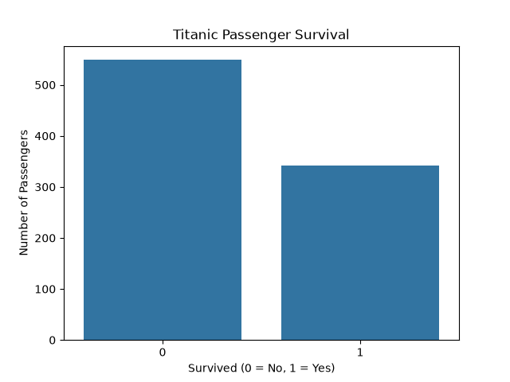

<br><br>

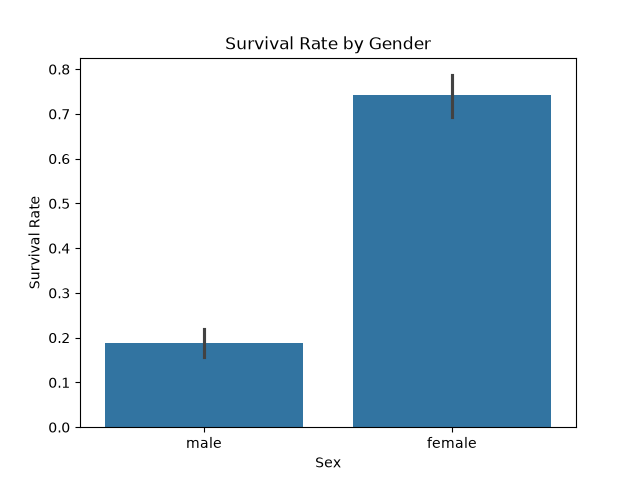

<br><br>

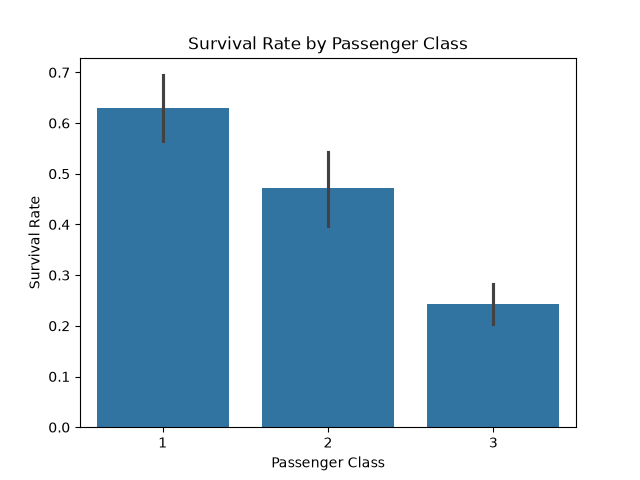

<br><br>

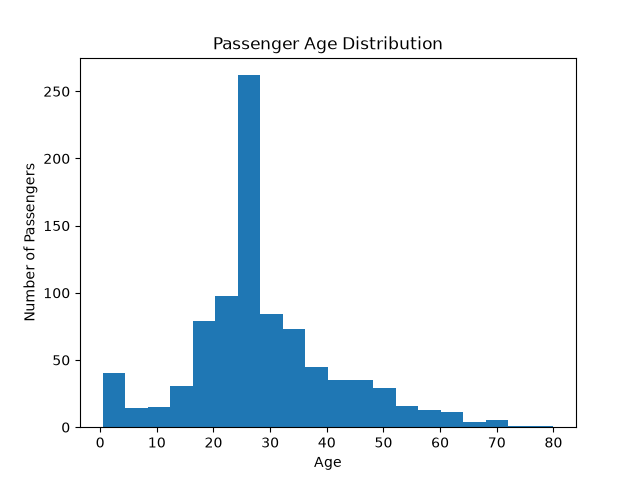

<br><br>

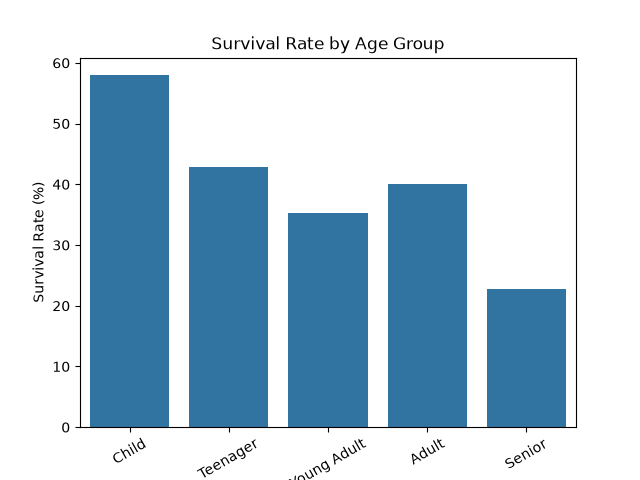

<br><br>

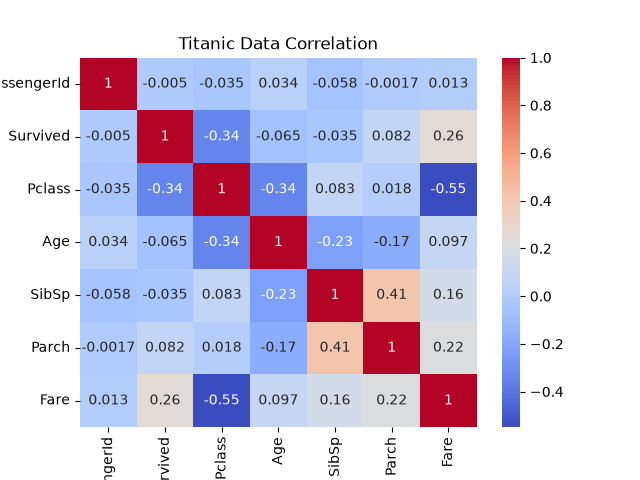

</div>

---

## 🖥️ Example Analysis

### Overall survival rate

The notebook calculates the overall survival rate with:

```python
rate = self.data["Survived"].mean() * 100
```

Since `Survived` is represented by `0` and `1`, its mean multiplied by 100 gives the survival percentage.

### Survival by gender

```python
self.data.groupby("Sex")["Survived"].mean() * 100
```

This calculates the survival percentage for each gender group.

### Survival by passenger class

```python
self.data.groupby("Pclass")["Survived"].mean() * 100
```

This calculates the survival percentage for each passenger class.

### Age groups

The notebook creates these age groups:

- Child: 0–12
- Teenager: 12–18
- Young Adult: 18–35
- Adult: 35–60
- Senior: 60–100

The exact group boundaries follow the `pd.cut()` bins used in the notebook.

*Results depend on the dataset and the cleaning steps performed in the notebook.*

---

## 📸 Output Screenshots

Notebook screenshots are included in the `Output1/` folder.

<div align="center">

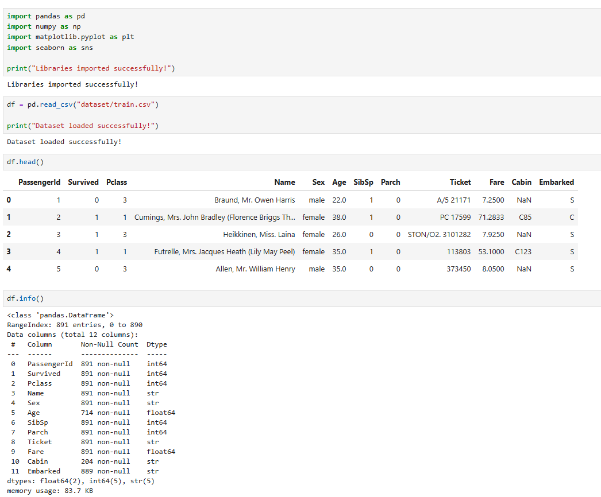

<br><br>

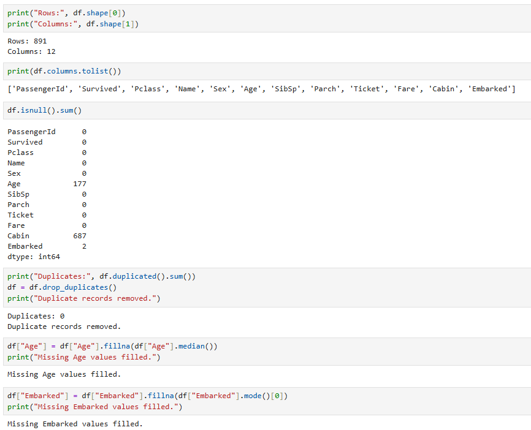

<br><br>

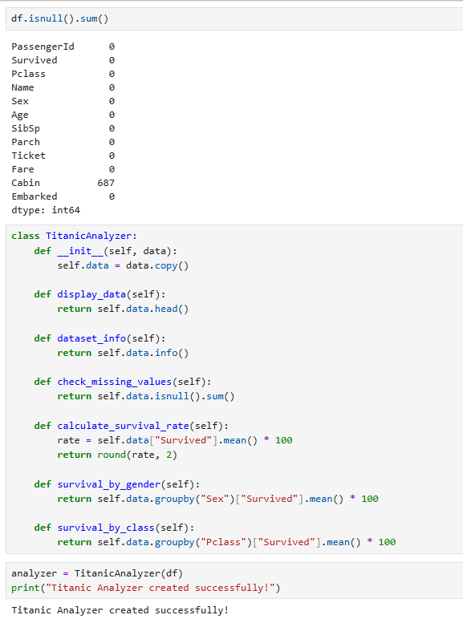

<br><br>

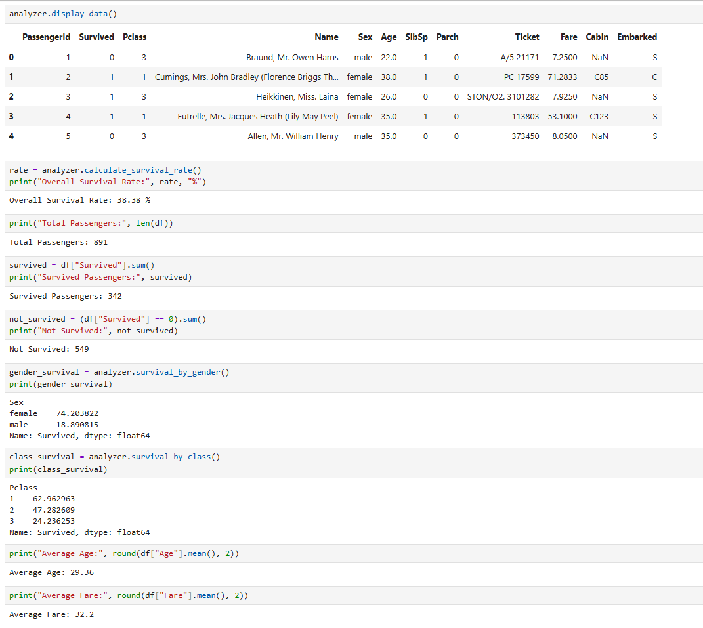

<br><br>

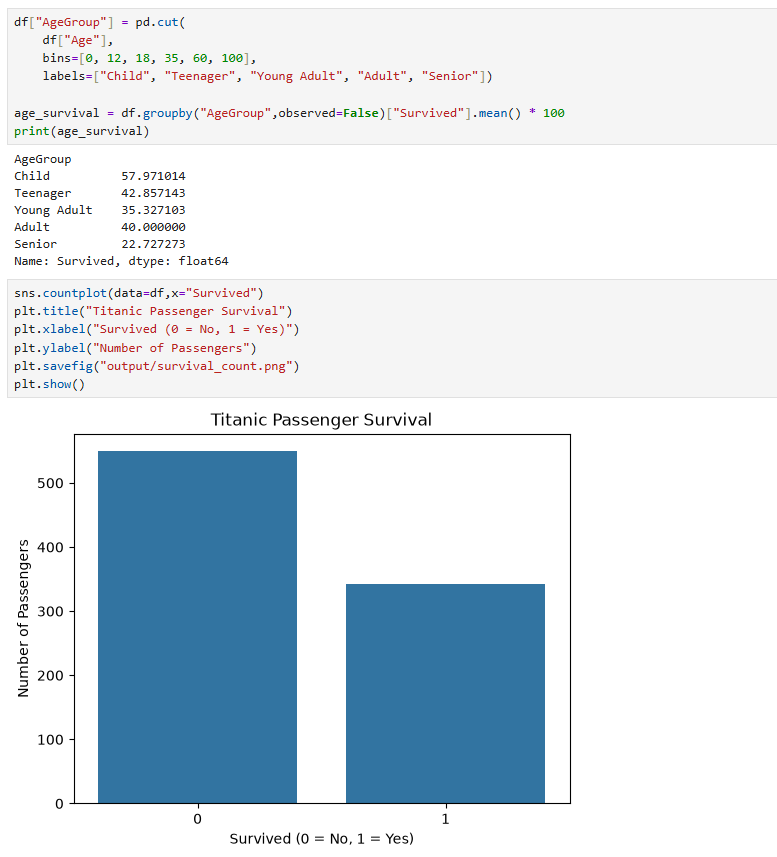

<br><br>

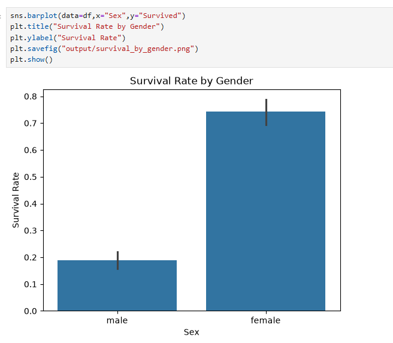

<br><br>

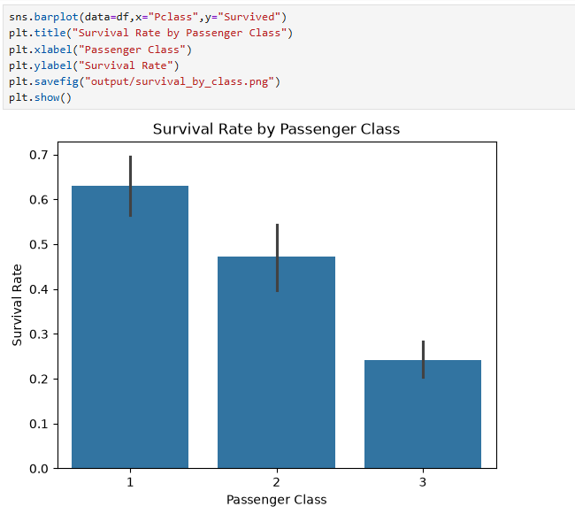

<br><br>

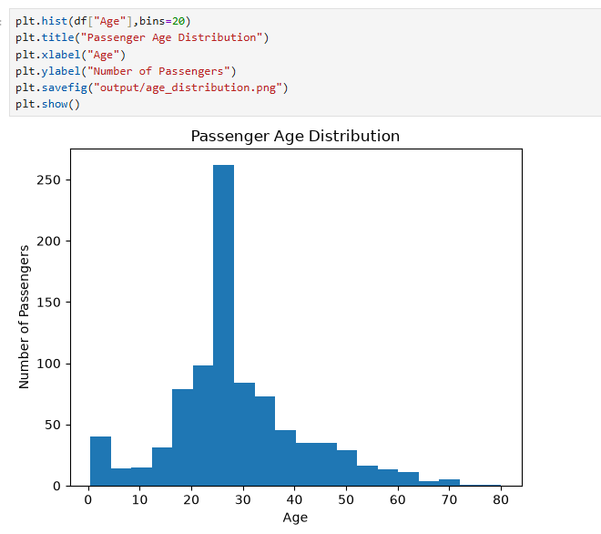

<br><br>

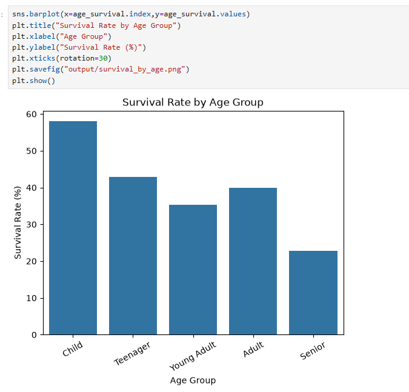

<br><br>

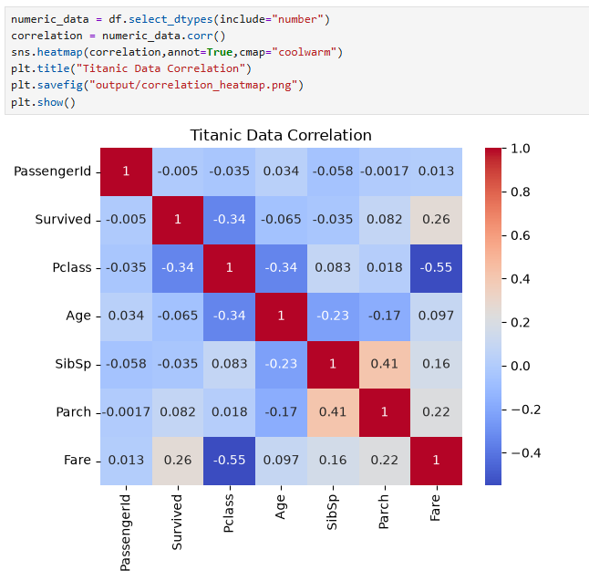

<br><br>

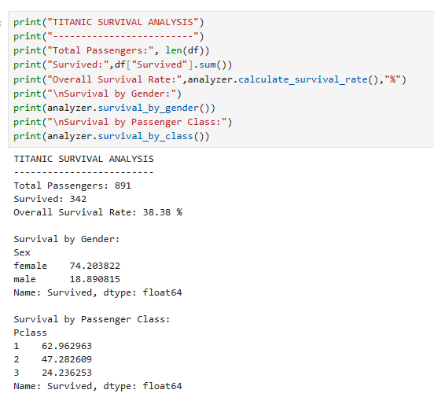

</div>

---

## 🎬 Project Demonstration

The demonstration video presents the execution of the Employee Management System, including creating records, displaying details, and checking inheritance.

<div align="center">

### ▶️ Complete Project Demonstration

</div>

[▶️ Watch Project Demonstration](Project%20Demonstration.mov)

---

## 📂 Project Structure

```text
Titanic Survival Analysis/
│
├── dataset/
│   └── train.csv
│
├── output/
│   ├── age_distribution.png
│   ├── correlation_heatmap.png
│   ├── survival_by_age.png
│   ├── survival_by_class.png
│   ├── survival_by_gender.png
│   └── survival_count.png
│
├── Output1/
│   ├── output-1.png
│   ├── output-2.png
│   ├── output-3.png
│   ├── ...
│   └── output-11.png
│
├── Titanic_Survival_Analysis.ipynb
└── README.md
```

---

## ⚙️ How to Run

### 1. Install Python

Check that Python 3 is installed:

```bash
python --version
```

### 2. Install required libraries

```bash
python -m pip install pandas numpy matplotlib seaborn jupyter
```

### 3. Open the project folder

Extract the ZIP file and open a terminal in the `Titanic Survival Analysis` folder.

### 4. Launch Jupyter Notebook

```bash
jupyter notebook
```

Or use JupyterLab:

```bash
jupyter lab
```

### 5. Open and run the notebook

Open:

```text
Titanic_Survival_Analysis.ipynb
```

Run the notebook cells from top to bottom. Keep the dataset at `dataset/train.csv` relative to the notebook's working directory so the CSV-loading cell can find it.

---

## 📦 Requirements

- Python 3.x
- Pandas
- NumPy
- Matplotlib
- Seaborn
- Jupyter Notebook or JupyterLab

Install the libraries:

```bash
python -m pip install pandas numpy matplotlib seaborn jupyter
```

---

## 🎓 Learning Outcomes

By completing this project, the learner practices:

- Reading and exploring a CSV dataset.
- Understanding rows, columns, data types, and missing values.
- Checking duplicate records and cleaning selected columns.
- Applying median and mode for missing-value handling.
- Using Pandas grouping and aggregation.
- Calculating survival percentages.
- Creating age categories with `pd.cut()`.
- Building visualizations with Matplotlib and Seaborn.
- Understanding numerical correlation.
- Organizing analysis with a Python class.
- Running a data analysis project in Jupyter Notebook.

---

## 👤 Developer

<div align="center">

### ADITI MODHVADIYA

**Python Developer • MERN Stack Developer**

<br>

📊 Built with Python, Pandas, NumPy, Matplotlib, and Seaborn

</div>

---

<div align="center">

### ⭐ Titanic Survival Analysis

**Load → Explore → Clean → Analyze → Visualize**

</div>
