<div align="center">

# 📊 Retail Sales Data Analyzer

### A Python-Based Data Cleaning, Analysis & Visualization Project

**Load • Validate • Clean • Analyze • Filter • Aggregate • Visualize**

<p>


</p>

</div>

---

## 📌 Project Overview

**Retail Sales Data Analyzer** is a menu-driven Python console application that reads retail sales records from a CSV dataset, checks data quality, cleans invalid records, calculates sales metrics, filters and aggregates data, and creates visualizations.

The project demonstrates core Python programming alongside **Object-Oriented Programming (OOP), lists/arrays, NumPy, Pandas, Matplotlib, and Seaborn**. The included dataset is designed for practice and contains more than 100 records, including intentional data-quality issues for validation and cleaning.

## 🎯 Objectives

- Load retail sales data from a CSV file.
- Identify missing, blank, invalid, negative, and duplicate values.
- Clean records and calculate total sales from price and quantity.
- Summarize sales performance using NumPy and Pandas.
- Filter records by category, product, or date range.
- Aggregate sales by product, category, and date.
- Visualize category sales, sales trends, and numerical correlations.
- Export cleaned data to a separate CSV file.

## ✨ Features

| Menu option | Feature | Description |
|:---:|---|---|
| 1 | Load CSV Dataset | Loads a CSV file and checks required columns. |
| 2 | Validate Dataset | Reports missing/blank values, duplicates, and invalid numeric values. |
| 3 | Clean Data | Converts data types, removes invalid records and duplicates, and recalculates sales. |
| 4 | Summary Metrics | Displays transaction count, total sales, average sale, popular product, and sales change. |
| 5 | Filter Data | Filters by category, product, or date range. |
| 6 | Aggregate Reports | Groups sales by product, category, and date. |
| 7 | Category Bar Chart | Visualizes total sales by product category. |
| 8 | Sales Trend Line Graph | Shows daily sales over time. |
| 9 | Correlation Heatmap | Displays correlations between price, quantity sold, and total sales. |
| 10 | Save Cleaned Dataset | Exports cleaned records to a new CSV file. |
| 0 | Exit | Closes the application. |

## 🧰 Technologies and Concepts

| Technology / concept | How it is used |
|---|---|
| Python 3 | Application logic, functions, loops, conditions, and input validation |
| Control structures | `if/elif/else`, `while`, and `for` loops |
| Lists and arrays | Working with collections and numerical data |
| OOP | `RetailAnalyzer` class and reusable methods |
| NumPy | Numerical arrays, sum, mean, and sales-change calculation |
| Pandas | CSV loading, data validation, cleaning, filtering, grouping, and export |
| Matplotlib | Chart figures, labels, titles, and layout |
| Seaborn | Bar chart, line plot, and correlation heatmap |
| Exception handling | Handles CSV parsing, encoding, and file-system errors |

## 📂 Project Structure

```text
retail_sales_data_analyzer/
├── README.md
├── retail_analyzer.py
├── retail_sales.csv
├── Output/
│   ├── output-1.png
│   ├── output-2.png
│   ├── output-3.png
│   ├── output-4.png
│   ├── output-5.png
│   ├── output-6.png
│   ├── output-7.png
│   ├── output-8.png
│   ├── output-9.png
│   ├── output-10.png
│   └── output-11.png
└── .ipynb_checkpoints/
    └── Retail_Sales_Analyzer_Step_by_Step-checkpoint.ipynb
```

The `.ipynb_checkpoints` folder is created by Jupyter automatically. The primary runnable application is `retail_analyzer.py`.

## 📊 Dataset Information

**Dataset file:** `retail_sales.csv`

The application expects these columns:

| Column | Description |
|---|---|
| `Date` | Date of the transaction |
| `Product` | Product name |
| `Category` | Product category |
| `Price` | Price per unit |
| `Quantity Sold` | Number of units sold |
| `Total Sales` | Total transaction value |

The dataset includes intentional data-quality problems for practice, such as missing or blank values, duplicate rows, and invalid numeric values.

## 🧹 Data Validation and Cleaning

The validation option checks each required column for missing and blank values, counts duplicate rows, and checks numeric fields for invalid or negative values.

The cleaning process:

1. Converts `Date` to a date value and numeric columns to numeric types.
2. Treats blank product and category values as missing.
3. Removes rows missing required date, product, category, price, or quantity values.
4. Removes rows with negative prices or quantities.
5. Recalculates `Total Sales` using `Price × Quantity Sold`.
6. Removes duplicate rows and resets the row index.
7. Formats dates as `YYYY-MM-DD`.

**Important:** Cleaning changes the dataset held in the application during that run. It does not overwrite the original `retail_sales.csv`. Use menu option `10` to save a cleaned copy.

## 📈 Visualizations

The application provides three charts:

- **Sales by Category:** compares total sales across product categories.
- **Retail Sales Trend:** plots daily total sales over time.
- **Correlation Heatmap:** shows correlations among price, quantity sold, and total sales.

## 🚀 Installation and Setup

### 1. Install Python

Use Python 3.10 or newer. Check your installation in Terminal:

```bash
python3 --version
```

### 2. Open the project folder

Extract the ZIP file, open Terminal, and move into the project directory. Update the path if you extracted it somewhere else.

```bash
cd retail_sales_data_analyzer
```

### 3. Install the required packages

```bash
python3 -m pip install pandas numpy matplotlib seaborn
```

If `pip` is unavailable, use the `python3 -m pip` command above. If Python itself is not found, install Python 3 first.

### 4. Run the application

```bash
python3 retail_analyzer.py
```

### 5. Load the dataset

When prompted for the CSV path, enter:

```text
retail_sales.csv
```

This works when Terminal is already open in the project folder. Otherwise, enter the full path to the CSV file.

## 🧭 Recommended Workflow

1. Select **1** and load `retail_sales.csv`.
2. Select **2** to review missing values, invalid numeric values, and duplicates.
3. Select **3** to clean the data.
4. Select **4** to view summary metrics.
5. Select **5** and **6** to filter records and view aggregated reports.
6. Select **7**, **8**, and **9** to display the charts.
7. Select **10** to save the cleaned dataset.
8. Select **0** to exit.

## 📸 Output Gallery

The screenshots below use the files included in the project's `Output` folder.

<div align="center">

<table>
<tr>
<td width="50%" align="center" valign="top">

### Output 1

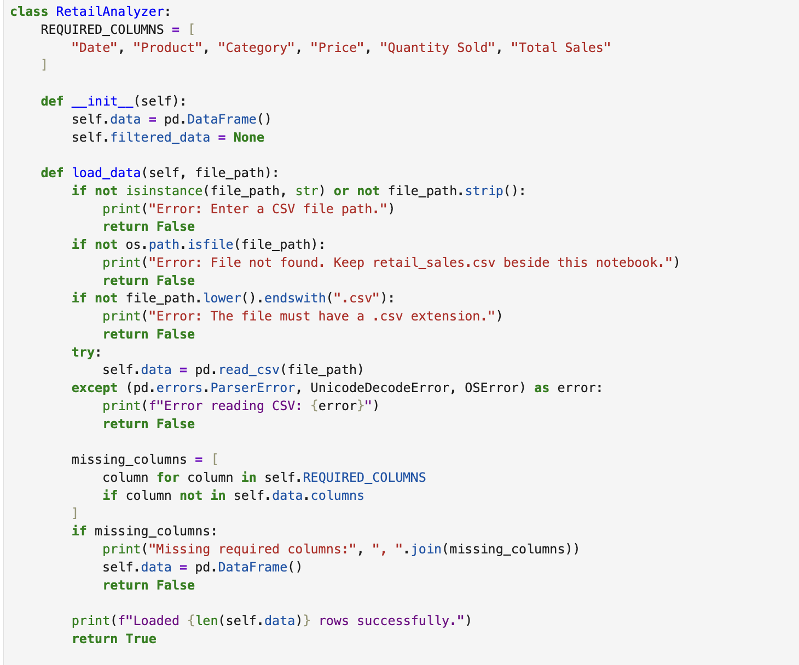

</td>
<td width="50%" align="center" valign="top">

### Output 2

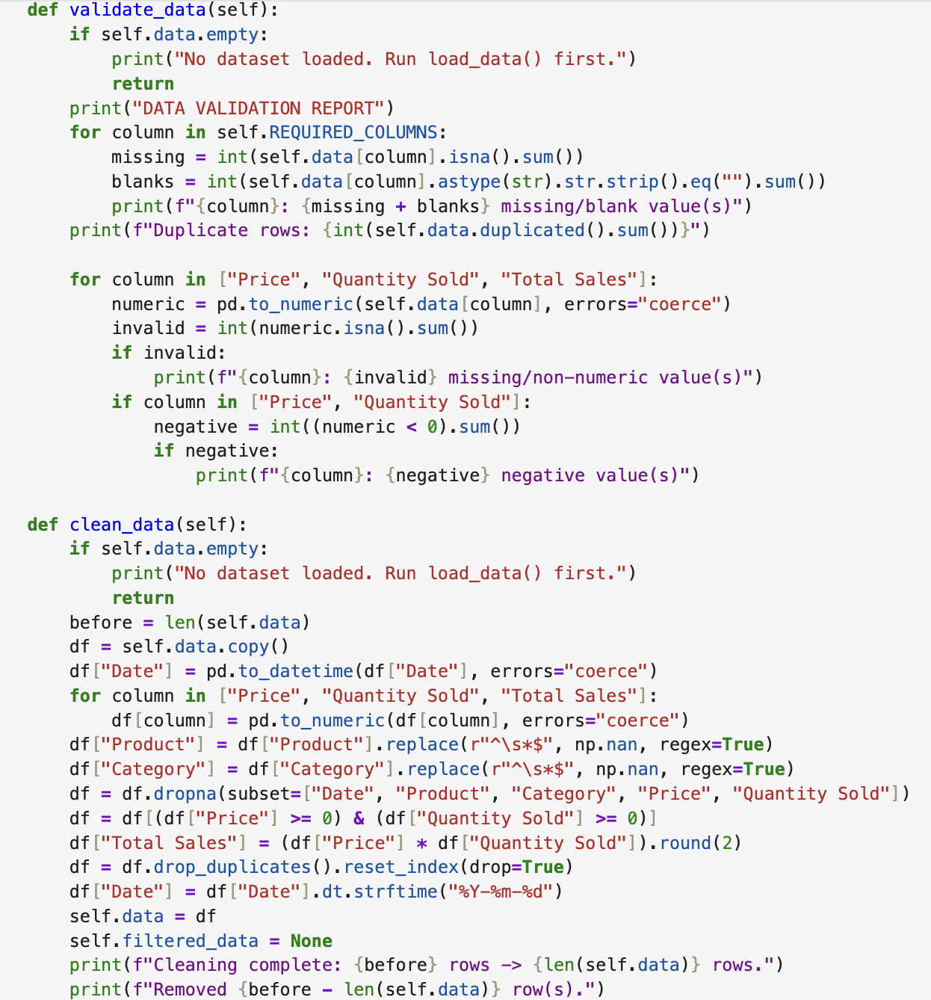

</td>
</tr>
<tr>
<td width="50%" align="center" valign="top">

### Output 3

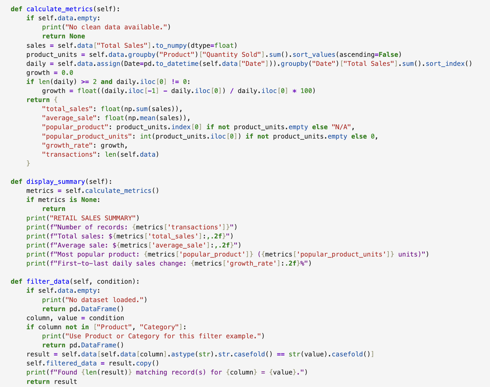

</td>
<td width="50%" align="center" valign="top">

### Output 4

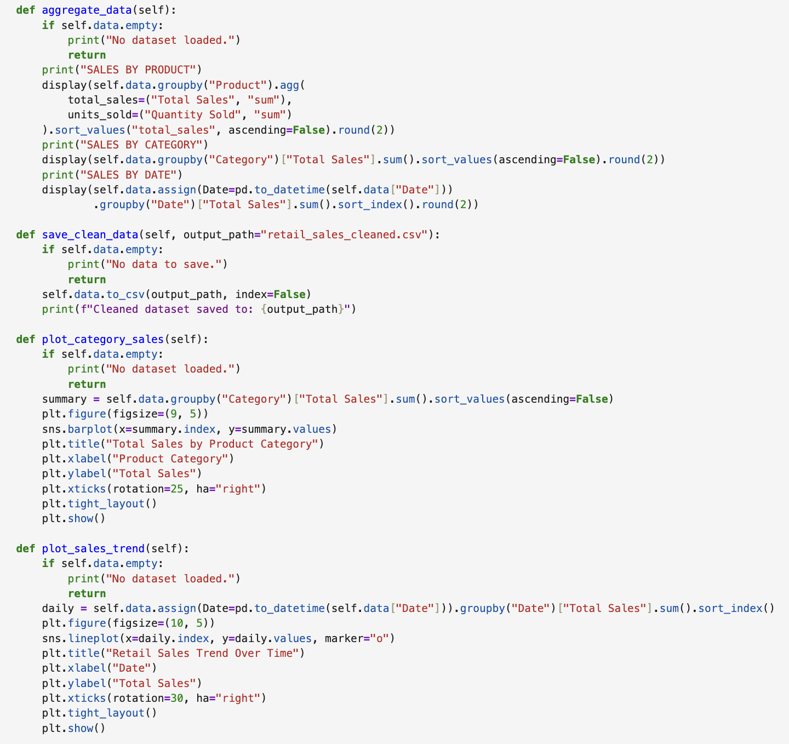

</td>
</tr>
<tr>
<td width="50%" align="center" valign="top">

### Output 5

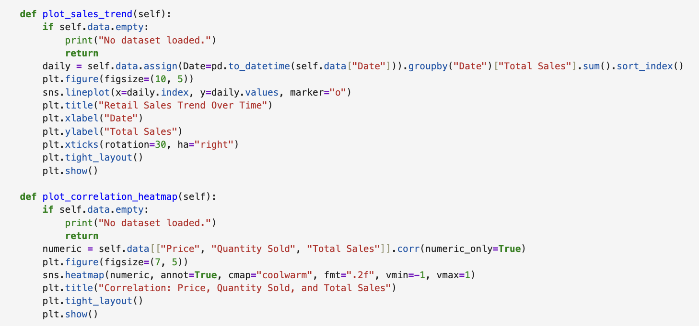

</td>
<td width="50%" align="center" valign="top">

### Output 6

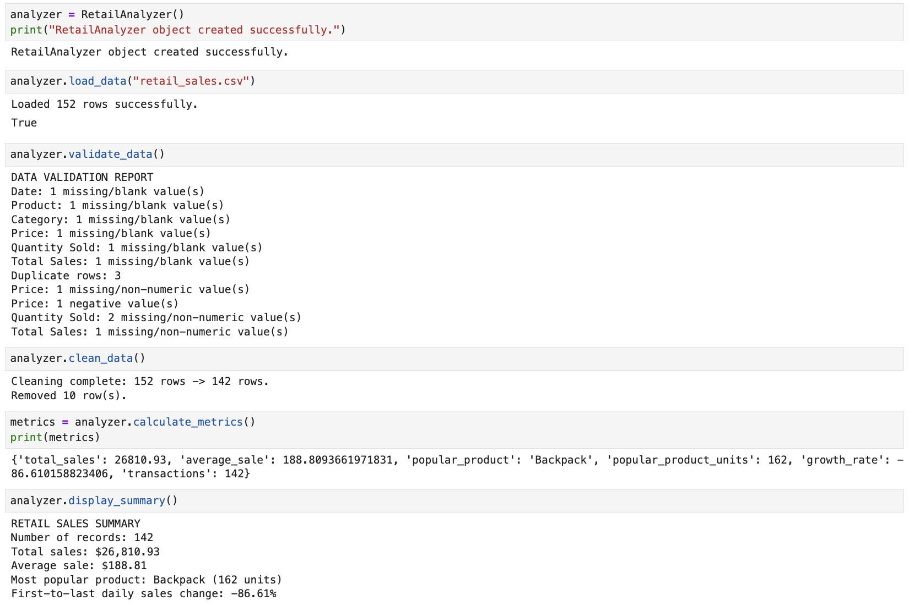

</td>
</tr>
<tr>
<td width="50%" align="center" valign="top">

### Output 7

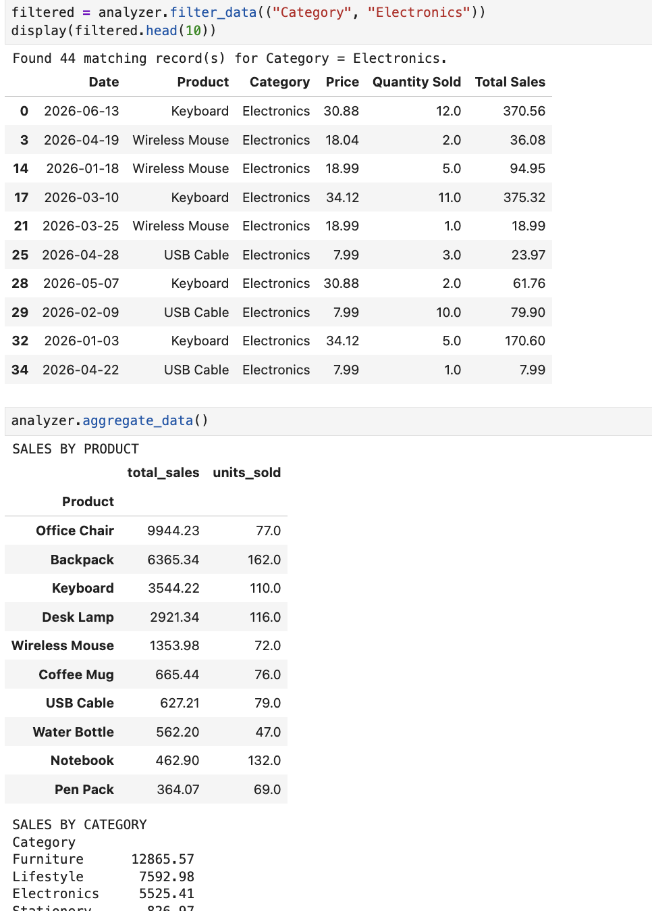

</td>
<td width="50%" align="center" valign="top">

### Output 8

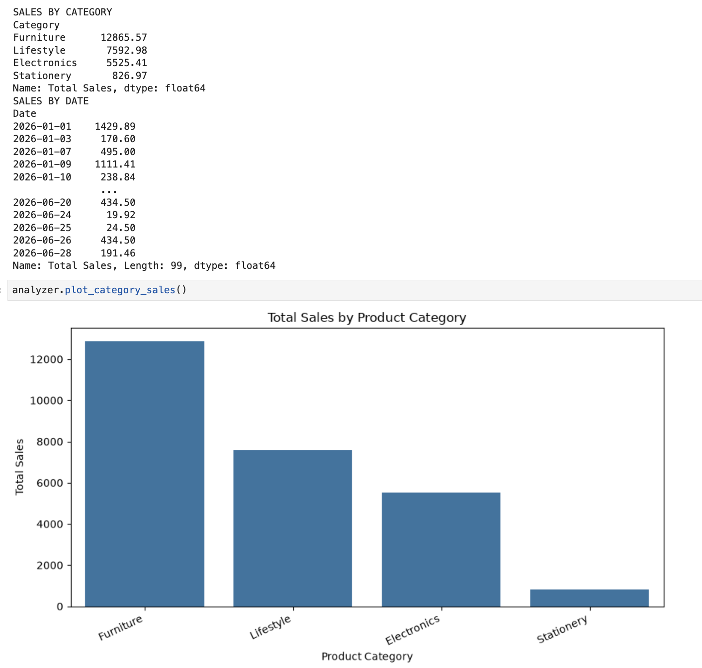

</td>
</tr>
<tr>
<td width="50%" align="center" valign="top">

### Output 9

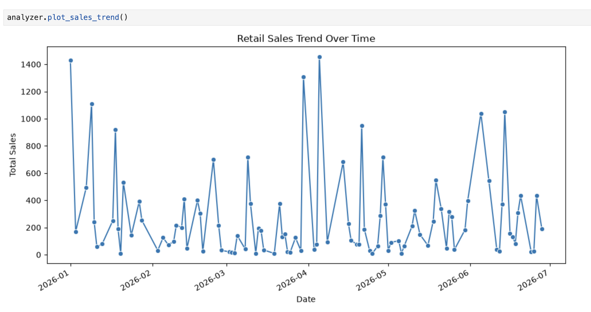

</td>
<td width="50%" align="center" valign="top">

### Output 10

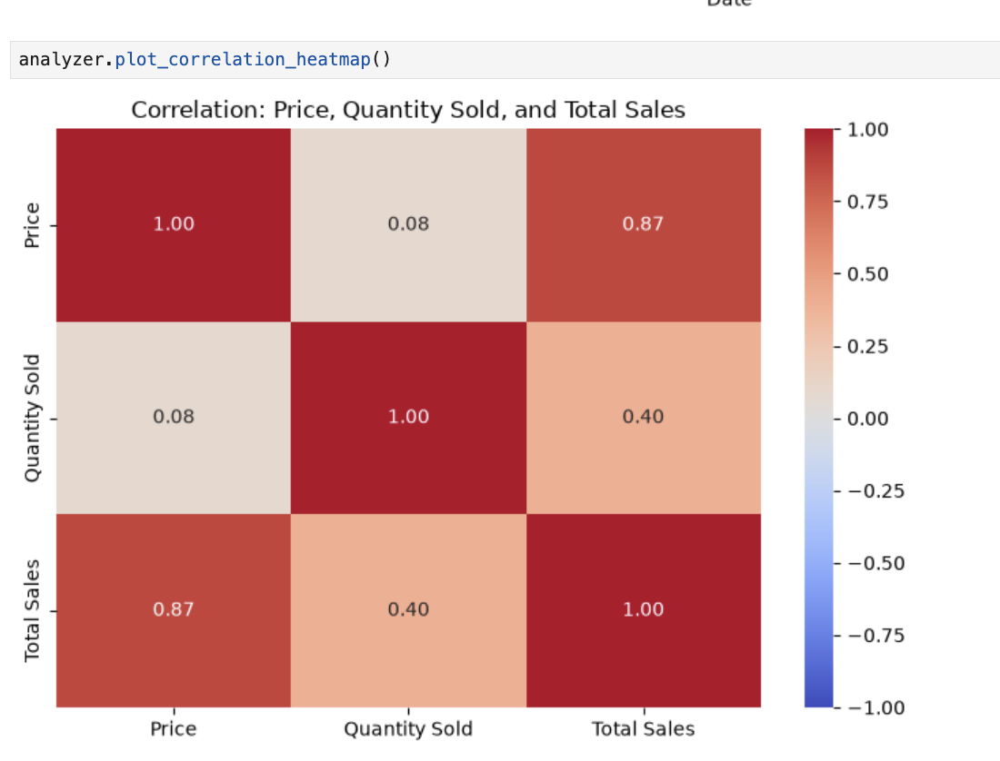

</td>
</tr>
<tr>
<td width="50%" align="center" valign="top">

### Output 11

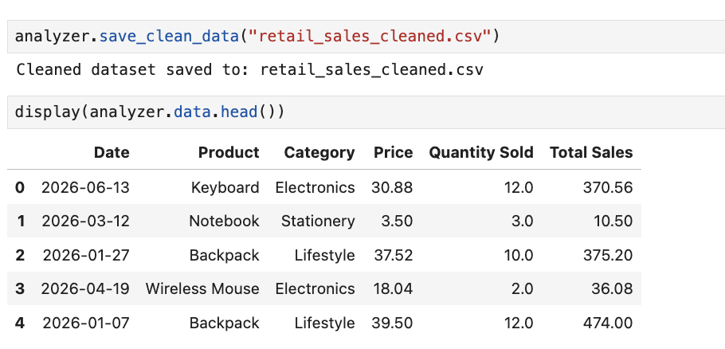

</td>
<td width="50%" align="center" valign="top">

</td>
</tr>
</table>

</div>

## 📦 Requirements

- Python 3.10 or newer
- `pandas`
- `numpy`
- `matplotlib`
- `seaborn`
- Input dataset: `retail_sales.csv`

Install all third-party dependencies with:

```bash
python3 -m pip install pandas numpy matplotlib seaborn
```

## 🎓 Learning Outcomes

- Build a menu-driven Python application.
- Organize logic using a class and methods.
- Load and process CSV datasets with Pandas.
- Use NumPy arrays and numerical functions.
- Identify and handle missing, invalid, and duplicate data.
- Apply filtering, grouping, and aggregation.
- Calculate useful sales metrics.
- Create visualizations with Matplotlib and Seaborn.
- Export cleaned data without replacing the source dataset.

## 🔮 Possible Future Improvements

- Add unit tests and automated data-quality reports.
- Allow users to choose custom columns for analysis.
- Add date-wise and monthly sales comparisons.
- Export summary reports to Excel or PDF.
- Add interactive charts and a graphical user interface.

## 📊 Project Snapshot

| Category | Details |
|---|---|
| Project | Retail Sales Data Analyzer |
| Language | Python 3 |
| Application type | Menu-driven console application |
| Main class | `RetailAnalyzer` |
| Dataset | `retail_sales.csv` |
| Data tools | Pandas and NumPy |
| Visualization tools | Matplotlib and Seaborn |
| Main concepts | Control structures, arrays, OOP, data cleaning, analysis, visualization |

## 🧑‍💻 Author

<div align="center">

### **Sujal Patel**

Python Developer / Learner

**Python • Pandas • NumPy • Matplotlib • Seaborn • OOP • Data Analysis**

</div>

---

## 📄 License

This project was created for educational and learning purposes.

<div align="center">

### 📊 Retail Sales Data Analyzer

**Turn raw retail data into meaningful insights.**

⭐ Explore • Learn • Analyze • Visualize

[⬆ Back to Top](#-retail-sales-data-analyzer)

</div>
